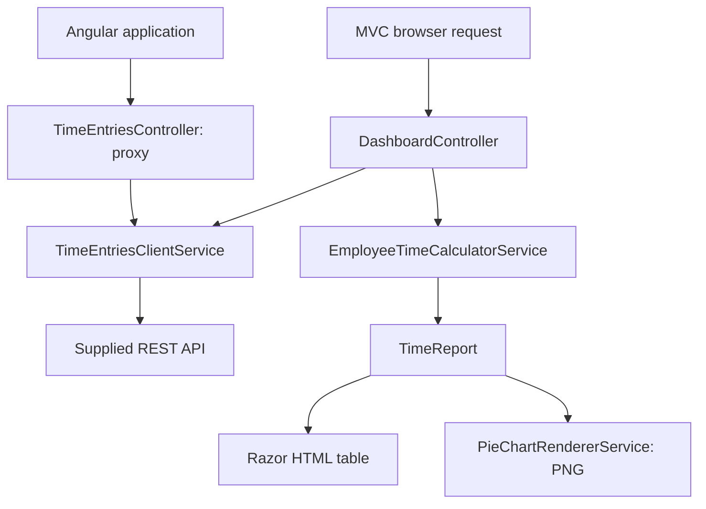

# TimeLedger · Employee time reports

Two implementations of the Rare Crew employee-time assignment: a C# ASP.NET Core MVC application and an Angular application. Both show employees ordered by total hours, highlight employees below 100 hours, and visualize each employee's share of the total.

The MVC HTML table and both PNG chart images are generated on the server in C#. No JavaScript is needed for the MVC report or its PNG download. Angular independently calculates its report in TypeScript and renders its chart with Chart.js.

## Run locally

### Prerequisites

- [.NET 10 SDK](https://dotnet.microsoft.com/en-us/download/dotnet/10.0), rather than only the runtime.
- [Node.js 24 LTS](https://nodejs.org/en/download), version 24.15 or newer, with npm.
- Internet access to restore dependencies and call the supplied API.

Commands below run from the repository root, unless a different directory is shown. They work in Windows PowerShell as well as macOS/Linux terminals. An IDE is optional; the solution can be opened in a .NET 10-compatible version of Visual Studio, Rider, or VS Code.

### 1. Set the supplied keys locally

Use the supplied API key for each implementation. Replace the placeholders below with the actual values. The C# and Angular settings are separate, even if their values happen to match.

```sh
dotnet user-secrets set "TimeEntries:CSharpApiKey" "PASTE_CSHARP_KEY" --project src/EmployeeTime.Web
dotnet user-secrets set "TimeEntries:AngularApiKey" "PASTE_ANGULAR_KEY" --project src/EmployeeTime.Web
```

These commands keep the real values outside the repository. Secret Manager is for local development. For a deployed environment, provide `TimeEntries__CSharpApiKey` and `TimeEntries__AngularApiKey` through the host's secret configuration. Never put a real key in Angular environment files, a committed configuration file, screenshots, or a public URL.

### 2. Start C# MVC and the Angular proxy

```sh
dotnet restore EmployeeTime.sln --locked-mode -m:1
dotnet run --project src/EmployeeTime.Web --launch-profile http
```

Open **http://localhost:5080**. Select **Download PNG** to save a standalone 1200 × 760 image containing the pie chart, employee names, and percentages. The download and table use the same fetched dataset. Reports are cached in the running server's memory with a 10-minute expiration; links can stop working sooner if the server restarts or the cache entry is evicted. Refresh the report if a link has expired. The page also uses a 720 × 720 C#-generated preview, with a responsive HTML legend.

### 3. Start Angular in a second terminal

Keep the C# server running. From the repository root:

```sh
cd apps/angular
npm ci
npm start
```

Open **http://localhost:4200**. The Angular development server forwards `/api/**` to `http://localhost:5080`. Its server endpoint selects the Angular key and forwards unaggregated time-entry fields; all Angular totals, sorting, highlighting, and percentages are computed in TypeScript.

Neither application substitutes sample records when the provider fails. Both display explicit error or empty states.

## Requirement mapping

| Requirement | C# MVC | Angular |
| --- | --- | --- |
| GET the supplied time-entry endpoint | `TimeEntriesClientService`, C# key | `TimeEntriesService` → backend proxy, Angular key |
| Calculate total time for each employee | `EmployeeTimeCalculatorService` | `calculateReport` |
| Order employees by total time | Descending, name as tie-breaker | Same |
| Highlight rows below 100 hours | Razor + CSS, with a text label | Angular binding + CSS, with a text label |
| Pie chart of time percentages | ScottPlot-generated PNG | Chart.js pie with legend and tooltips |
| Generate a PNG file in C# | Downloadable image; generated by C# | Not required for Angular |
| MVC application | Controllers, models/services, Razor views | Separate Angular application |

## Architecture

The application has one .NET web project and one test project. A small assignment does not need a database, repository layer, authentication, or a separate project for every responsibility.



- **API boundary:** `TimeEntriesClientService` handles HTTP, JSON, timeout, cancellation, and safe provider errors. `ITimeEntriesClientService` lets integration tests substitute controlled responses without hitting the real provider.
- **Business rules:** `EmployeeTimeCalculatorService` is a pure calculation with no HTTP or UI dependency. The Angular equivalent is also a pure function.
- **Presentation:** Razor formats values and highlights rows; the controller coordinates the request. ScottPlot generates PNG bytes in memory. The calculated report is cached under a per-report ID with a 10-minute expiration. A C# file endpoint renders the full-size PNG from that cached report when requested and returns it with an attachment filename, without another provider fetch. A missing or expired cache entry returns a clear 404 response asking the user to refresh. The preview image is rendered with the page and embedded as a data URI.
- **Angular state:** a discriminated union distinguishes loading, error, and loaded states. A separate component owns and disposes of Chart.js instances.
- **Configuration:** only the server sees the keys. HTTP-client URL logging is disabled because the upstream API requires a query-string key. Provider response bodies and raw transport exceptions are not exposed to users.

### Main files

| File | Purpose |
| --- | --- |
| `src/EmployeeTime.Web/Program.cs` | Register services and configure request handling |
| `Models/TimeEntry.cs` | Map upstream JSON fields, including the spelling `StarTimeUtc` |
| `Services/TimeEntriesClientService.cs` | Retrieve the selected dataset |
| `Services/EmployeeTimeCalculatorService.cs` | Validate, group, sum, and sort records |
| `Services/PieChartRendererService.cs` | Generate C# PNG chart images |
| `Controllers/DashboardController.cs` | Build the MVC view model from one fetch |
| `Views/Dashboard/Index.cshtml` | Render the report as HTML |
| `Controllers/TimeEntriesController.cs` | Proxy the Angular dataset without exposing its key |
| `apps/angular/src/app/calculate-report.ts` | Independent Angular calculation |
| `apps/angular/src/app/pie-chart.ts` | Chart lifecycle and accessible legend |
| `tests/fixtures/report-cases.json` | Shared synthetic calculation examples for C# and Angular |

Paths beginning with `Models`, `Services`, `Controllers`, or `Views` in this table are relative to `src/EmployeeTime.Web`.

## Calculation decisions

The assignment leaves data-cleaning rules unspecified. These are explicit assumptions, rather than corrections inferred from the data:

1. Exclude any entry with a non-null `DeletedOn`.
2. Trim names and exclude null, empty, or whitespace-only names. Group by the remaining **exact, case-sensitive name**, because the API supplies no employee identifier. Different people with the same name cannot be distinguished reliably.
3. Require valid ISO calendar timestamps with seconds, an optional fractional part containing one to seven digits, and an optional `Z` UTC marker or numeric offset. Interpret timestamps without an offset as UTC, as the API's field names indicate. Reject impossible calendar dates rather than allowing browser date normalization.
4. Calculate elapsed time as end minus start. Exclude negative durations; do not take their absolute value or swap times. Accept zero duration and multi-day records.
5. Add all valid durations before converting to display values. C# sums integer ticks; Angular sums integer milliseconds. Both convert employee totals to hours only after aggregation, avoiding rounding each entry to fractional hours before applying the 100-hour boundary. Angular's timestamp parsing discards submillisecond precision, while C# retains up to seven fractional digits; results can therefore differ for inputs with submillisecond timestamps.
6. Sort by hours descending; sort tied names using ordinal comparison. Compare the unrounded total against **strictly less than 100 hours**. Exactly 100 is not highlighted. A total just below 100 may display as `100.00` and still be correctly highlighted.
7. Calculate share as `employee hours / all included hours × 100`. Show hours to two decimal places and shares to one. Display rounding can make visible percentages differ slightly from 100% in total.
8. With no valid records, show an empty state. With valid records totaling zero, show the table and an explanation instead of inventing a pie chart.

Exclusion counts are mutually exclusive, evaluated in the order above. Null JSON items count as invalid timestamp records. Records are summed as returned; overlapping intervals are not merged. The report covers every supplied entry, not a presumed monthly or payroll period. Refreshing fetches current provider data.

## Verify

From the repository root:

```sh
dotnet test EmployeeTime.sln --configuration Release --no-restore -m:1
```

The command above assumes the restore step in the local setup has completed. It builds the solution in Release configuration before running the tests.

From `apps/angular`, after `npm ci`:

```sh
npm test
npm run build
```

Tests use synthetic data and need no real API keys. They cover grouping, name trimming, deterministic ties, UTC/offset interpretation, multi-day and zero durations, deleted/missing/invalid records, impossible dates, exact threshold behavior (including 300 twenty-minute sessions totaling exactly 100 hours), delayed rounding, and percentage totals. HTTP-client tests cover source-key selection, malformed responses, provider errors, timeouts, cancellation, and safe errors. MVC integration tests exercise real routing, Razor HTML, name escaping, empty/error states, and decoding a generated PNG with its expected dimensions and attachment response headers. A missing chart ID returns 404 without making a provider request. Angular tests cover the HTTP boundary and loading, retry, empty, zero, and escaped-name states.

The included GitHub Actions workflow is configured to run the .NET tests on Windows and Ubuntu, and the Angular tests and production build on Ubuntu, on pushes and pull requests. Check the repository's Actions tab for actual hosted run results.

## Troubleshooting

- **`dotnet` is not recognized:** install the SDK, restart the terminal, and check `dotnet --info`.
- **SDK mismatch:** `global.json` selects .NET 10 and permits later .NET 10 feature bands. Installing only a runtime is insufficient.
- **Missing key:** configure the relevant setting using `dotnet user-secrets` against the web project and use the `http` development profile. Configuring only one key is enough to run its corresponding report.
- **Provider unavailable:** check the key and the provider's availability. A provider failure intentionally produces an error, not a fabricated report.
- **Angular cannot load data:** keep the backend running on port 5080 and use `npm start`, which includes the development proxy. Angular needs its server endpoint even though it performs the calculations itself.
- **Port in use:** stop an old instance with Ctrl+C. If you change the C# port, also change `apps/angular/proxy.conf.json`.
- **Linux chart font or native errors:** ScottPlot includes SkiaSharp Linux native assets transitively. A minimal Linux image may additionally need `libfontconfig1`, `libfreetype6`, and installed fonts. A normal Windows installation needs no Linux packages.
- **Building is different from hosting:** `npm run build` creates static Angular files but does not launch a server. A deployed Angular app must forward `/api` to the backend; the supplied proxy is for local development. This assignment uses HTTP loopback for simple local setup; deploy behind an HTTPS host and configure its allowed hostname.

## Dependencies and references

- [.NET MVC](https://learn.microsoft.com/en-us/aspnet/core/mvc/overview?view=aspnetcore-10.0)
- [Local development secrets](https://learn.microsoft.com/en-us/aspnet/core/security/app-secrets?view=aspnetcore-10.0)
- [Angular compatibility](https://angular.dev/reference/versions)
- [ScottPlot pie charts](https://scottplot.net/cookbook/5/Pie/)
- [Chart.js pie charts](https://www.chartjs.org/docs/latest/charts/doughnut.html)

The project uses .NET 10, Angular 22, ScottPlot 5, Chart.js 4, xUnit, and Vitest. Lockfiles are included for repeatable dependency installation. Third-party packages retain their respective licenses.
